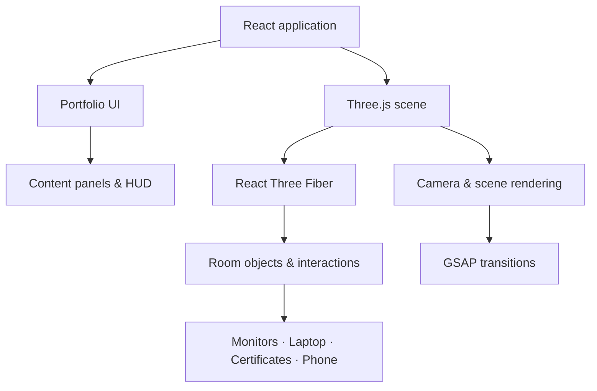

<div align="center">

# ABHINAV / 3D

### Not another portfolio. A room you can explore.

A personal portfolio built as an interactive 3D environment — where the interface is the space, the objects are the navigation, and the projects are waiting inside.

**[ ENTER THE ROOM ↗](https://abhinav-3d-portfolio-red.vercel.app/) · [ SOURCE CODE](https://github.com/Abhinav1480/3D-portfolio)**

`REACT` &nbsp; `THREE.JS` &nbsp; `TYPESCRIPT` &nbsp; `CREATIVE DEVELOPMENT`

</div>

---

## 00 / The concept

What if a developer's portfolio wasn't a page full of sections?

What if you could walk into it?

This project turns my portfolio into an interactive virtual room. A laptop introduces me. Monitors reveal my work. Certificates live on the walls and shelf. A phone opens my contact details.

The room isn't just a background behind the content. **The room is the interface.**

I built this experience to explore the space between frontend engineering, 3D graphics, interaction design, and visual storytelling.

---

## 01 / Choose where to explore

```text
                    ┌──────────────────────┐
                    │       OVERVIEW       │
                    │      The room        │
                    └──────────┬───────────┘
                               │
               ┌───────────────┼───────────────┐
               ▼               ▼               ▼
          ┌─────────┐     ┌──────────┐    ┌──────────┐
          │  ABOUT  │     │ PROJECTS │    │EXPERIENCE│
          │ Laptop  │     │ Monitors │    │  & Roles │
          └─────────┘     └──────────┘    └──────────┘
                               │
                               ▼
                       ┌──────────────┐
                       │ CERTIFICATES │
                       │  Wall & shelf│
                       └──────┬───────┘
                              ▼
                       ┌──────────────┐
                       │   CONTACT    │
                       │    Phone     │
                       └──────────────┘
```

| Destination | Look for |
|---|---|
| **About** | The laptop |
| **Projects** | The project monitors |
| **Experience & Roles** | The experience monitor |
| **Certificates** | The framed certificates and floating shelf |
| **Contact** | The phone on the coffee table |

The live room includes a guided camera tour as well as free exploration. The goal is to let visitors discover the experience rather than forcing every interaction into a traditional navigation bar.

**Best experienced on desktop.** The live site is the place to experience the actual room, camera movement, and object interactions.

## 02 / Inside the room

### The workspace

A stylized environment with furniture, monitors, a laptop, plants, a sofa, a guitar, decorative details, and carefully composed lighting.

### The interfaces

The physical objects connect the 3D environment to actual portfolio content. Clicking an object can take the visitor deeper into the corresponding experience.

### The motion

Camera transitions and object interactions connect the different destinations. Motion is used to provide context and guide attention, rather than being added only for decoration.

### The details

Certificates, the bookshelf, decorative objects, and the contact phone help make the environment feel like a personal workspace rather than a conventional portfolio template.

## 03 / Selected work

These projects represent different directions in my development work.

<table>
<tr>
<td width="50%" valign="top">

### 01 — ExamOS

A study workspace designed to bring academic resources into one organized experience.

**[Explore source ↗](https://github.com/Abhinav1480/ExamOS)**

</td>
<td width="50%" valign="top">

### 02 — ORCA

A marine intelligence project focused on collaborative agents and ecosystem reasoning.

**[Explore source ↗](https://github.com/Abhinav1480/sih)**

</td>
</tr>
<tr>
<td width="50%" valign="top">

### 03 — Clinic Desk

A clinic-management project developed in a collaborative setting.

**[Explore source ↗](https://github.com/vedant7007/clinic-desk)**

</td>
<td width="50%" valign="top">

### 04 — StockPilot

An inventory and warehouse management platform.

**[Explore source ↗](https://github.com/Abhinav1480/stock-pilot)**

</td>
</tr>
</table>

## 04 / The engineering behind the experience

The implementation brings together a React application and a real-time 3D scene.



### Core stack

| Layer | Technology |
|---|---|
| Interface | React 19 |
| Language | TypeScript |
| 3D rendering | Three.js |
| React integration for 3D | React Three Fiber |
| 3D helpers | React Three Drei |
| Animation | GSAP |
| Smooth scrolling | Lenis |
| Development and build | Vite |
| Styling | Tailwind CSS |
| Deployment | Vercel |

### What this project explores

**3D and interface integration** — Connecting scene objects to useful UI and content.

**Camera-driven navigation** — Coordinating viewpoints, transitions, and interaction states.

**Creative frontend engineering** — Building a personal experience that goes beyond conventional page layouts.

**Interaction and state management** — Making object clicks, panels, and navigation work together coherently.

**Visual performance** — Balancing scene detail, readable interfaces, and smooth movement.

## 05 / Run the room locally

Want to look inside the code?

### Requirements

- Node.js
- npm
- Git

### Setup

```bash
git clone https://github.com/Abhinav1480/3D-portfolio.git
cd 3D-portfolio
npm install
```

Create a local environment file:

**Windows PowerShell**

```powershell
Copy-Item .env.example .env.local
```

**macOS / Linux**

```bash
cp .env.example .env.local
```

Configure any required environment variables in `.env.local`. Never commit real API keys or secrets.

Start development:

```bash
npm run dev
```

Run the available TypeScript check and production build:

```bash
npm run lint
npm run build
```

To preview the production build locally:

```bash
npm run preview
```

## 06 / About the creator

**Abhinav Nakka**  
Full-Stack Developer · UI Engineer · Creative Developer

I'm a Computer Science and Engineering student interested in building full-stack applications, polished interfaces, and interactive web experiences.

I enjoy turning ideas into working software and experimenting with how technology and visual design can make digital experiences more engaging.

This portfolio is an expression of that approach: a practical application, an interface-design experiment, and an ongoing exploration of the web as a space people can interact with.

## 07 / Find me outside the room

<div align="center">

**[LinkedIn ↗](https://www.linkedin.com/in/abhinav-nakka-5133b1356/)**

**[GitHub ↗](https://github.com/Abhinav1480)**

**[Email ↗](mailto:nakkaabhinav19@gmail.com)**

---

**[ENTER THE ROOM AGAIN ↗](https://abhinav-3d-portfolio-red.vercel.app/)**

*Designed to be explored. Built to be experienced.*

</div>
